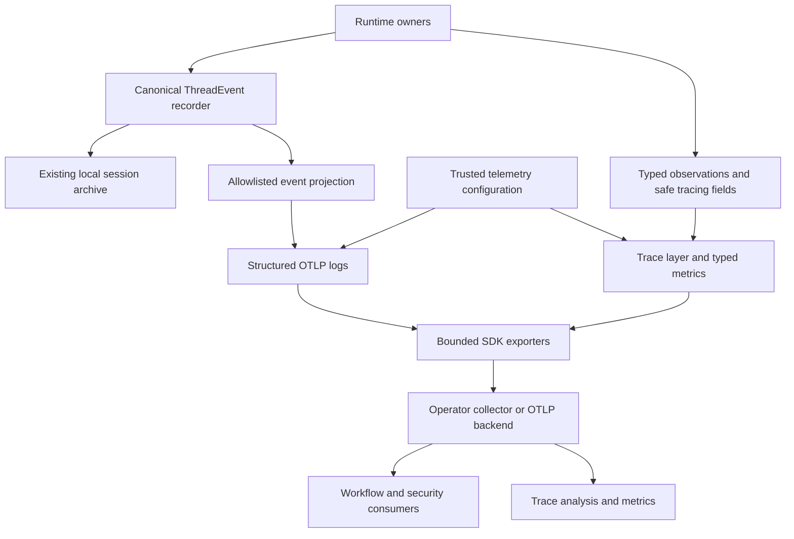

# Diapason observability technical design

- **Status:** Proposed; no runtime implementation is delivered by this document.
- **Updated:** 2026-11-03.
- **Audience:** Runtime, provider, safety and configuration maintainers;
  operators and telemetry consumers.
- **Scope:** OpenTelemetry (OTel) traces, metrics and structured logs for
  vtcode. Diapason remains the proposed fork name. Existing crate names are
  retained.
- **Authority:** [RFC 0002](../rfcs/rfc-0002-diapason-observability.md) states
  the proposal; this document specifies its target contracts. The
  [GIST roadmap](../project/diapason-observability-roadmap.md) sequences
  delivery. Neither document authorizes runtime changes merely by being merged.

## 1. Business outcomes and boundaries

An operator must be able to answer why an agent run failed, where it waited,
what it consumed, which authority permitted its actions, and whether its work
was verified. These questions span a model call, a terminal session and an
external workflow. The design exports interoperable evidence without owning
workflow scheduling, billing, security adjudication, or a telemetry backend.

| Consumer question                              | Required evidence                                                                               | Boundary                                                                     |
| ---------------------------------------------- | ----------------------------------------------------------------------------------------------- | ---------------------------------------------------------------------------- |
| Why did this task stall or fail?               | Task/run/attempt joins, operation timelines, retries, waits, cancellation and classified errors | Missing telemetry is unknown, never proof of inactivity                      |
| What did the task cost?                        | Normalized tokens, provider billing evidence, pricing revision, known and unknown contributions | Estimates are distinct from provider charges; no invoice authority           |
| Was the change useful and verified?            | Gate/review outcomes, candidate identity, artifact references and evidence source               | Tool success is not task success; external verdicts retain their issuer      |
| What did the agent do under which permissions? | Policy revision, decision ID, approval wait, actual enforcement outcome                         | Export cannot authorize actions; no completeness or tamper-proof audit claim |
| Can workflows recover and compare providers?   | Stable logical IDs, new attempt IDs, lineage links and usage provenance                         | No dependence on Dakar, df12-build, or Corbusier storage schemas             |

_Table 1: Business questions and the limits of telemetry evidence._

The
[RFC's consumer evidence](../rfcs/rfc-0002-diapason-observability.md#53-correlation-and-consumer-requirements)
provides provenance. Dakar already reports review-stage usage and estimated
cost. df12-build has a delivered observability contract with further collector
and runtime wiring planned. Corbusier's durable audit model is proposed. These
are requirements inputs, not evidence that their full data planes exist.

The v1 target includes all three signals, interactive and non-interactive CLI,
Agent Client Protocol (ACP) sessions, model streaming, tools, Model Context
Protocol (MCP), subagents, approvals, hooks, compaction and session recovery.
Backend dashboards, a durable telemetry spool, automatic code-quality scoring,
and a compliance audit ledger are excluded. Existing session persistence
remains independent. No code, content, or credentials leave the process by
default.

## 2. Current implementation and integration seams

This inventory describes base commit
`ca5badd345722a15fcf3d891c91a3053fec6fc08`, inspected on 2026-11-03. Source
paths retain vtcode naming.

| Existing seam                                                                    | Observed behaviour                                                                              | Required change                                                                                                   |
| -------------------------------------------------------------------------------- | ----------------------------------------------------------------------------------------------- | ----------------------------------------------------------------------------------------------------------------- |
| [Tracing bootstrap](../../src/main_helpers/tracing.rs)                           | Separate initialization paths install a global subscriber, file/TUI layers and error collection | One composition root with independently filtered local and export layers                                          |
| [Telemetry configuration](../../crates/codegen/vtcode-config/src/telemetry.rs)   | Trajectory, dashboard, retention and performance settings                                       | Add a distinct nested `telemetry.otel` configuration; do not reinterpret existing switches                        |
| [Execution events](../../crates/common/vtcode-exec-events/src/lib.rs)            | `ThreadEvent` owns lifecycle semantics; optional `OtelEmitter` starts isolated spans            | Keep the event contract; replace isolated-span projection with safe event export and owner-created duration spans |
| [Event recording](../../crates/codegen/vtcode-core/src/core/agent/events/mod.rs) | Events fan out to callback, recorder and memory                                                 | A single telemetry projection at the canonical emission seam, not each subscriber                                 |
| [Session persistence](../../crates/codegen/vtcode-memory/src/event_log.rs)       | Explicit flush; `Drop` is best effort                                                           | Preserve finalization before bounded telemetry shutdown                                                           |
| [Core metrics](../../crates/codegen/vtcode-core/src/metrics/mod.rs)              | JSON/Prometheus snapshots and provider metric methods                                           | Audit actual producers; provider-method existence does not prove production wiring                                |
| [Workspace dependencies](../../Cargo.toml)                                       | `opentelemetry` 0.32 and `tracing-opentelemetry` 0.33                                           | Select a mutually compatible SDK/exporter family; no silent upgrade assumption                                    |

_Table 2: Implementation evidence and proposed ownership changes._

Provider normalization and session accounting already exist, but session totals
cannot reconstruct provider-attempt charges. Outer agent-task retry metrics
must not be labelled as provider retries. Existing `mcp.tools.call` spans need
parenting and safe export review, not an additional identical span. Runtime
instrumentation must follow actual dispatch/stream completion and tool
execution owners across core and binary runloops; crate names alone do not
locate them.

## 3. Architecture and Rust ownership

The diagram separates authoritative session records from exported projections.
Both receive observations from runtime owners; exporter failures have no return
path into execution policy or workflow control.

_Figure 1: Observation, persistence and export boundaries._

Add a small proposed `vtcode-telemetry` crate under `crates/common/`. It owns
sanitized observation types, instrument handles, schema constants, context
validation and SDK/exporter lifecycle. It may depend on `vtcode-exec-events`;
the event crate must not depend back on it. Configuration deserialization stays
in `vtcode-config`; the binary converts validated settings into telemetry
options. Core and provider adapters emit observations without initializing
globals. Runtime event additions belong in `ThreadEvent`, not a rival business
event enum. A projection record is an export representation of that contract,
not an alternate source of runtime truth.

The binary owns one `TelemetryRuntime`, which owns tracer, meter and logger
providers, exporter workers, cancellation and join handles. Library consumers
can inject no-op or test instruments and a caller-owned subscriber. Installing
a second global subscriber is an explicit diagnostic, not a silent success or a
panic. Standalone library crates never replace an embedding application's
subscriber or global meter provider.

Use `tracing` for lexical operations and `tracing-opentelemetry` to bridge
allowlisted spans. Use typed OTel `Meter` counters, histograms and up/down
instruments directly, cached at initialization. This preserves SDK views,
resources and exemplars without an additional global recorder. The Rust
[`metrics` facade](https://docs.rs/metrics/0.24.6/metrics/) is viable for a
backend-neutral library, but a second recorder/bridge here adds lifecycle and
aggregation ownership with no required consumer benefit. Do not infer business
metrics from `tracing` events or enable a parallel `MetricsLayer` for them.

Structured business records use the OTel Logs API, separate from trace span
events.
[`tracing-opentelemetry`](https://docs.rs/tracing-opentelemetry/0.34.0/tracing_opentelemetry/)
does not itself supply log export. A narrow typed projection is preferable to
bridging every existing debug message. Local diagnostic logging retains its
existing behaviour; enabling OTLP never turns `RUST_LOG=trace` into permission
to export arbitrary debug fields. Export layers subscribe only to dedicated
safe instrumentation targets; an arbitrary legacy span/event is not exported
just because its parent is exported. Field validation occurs before calling
`tracing` or the Logs API, not only in an exporter processor. Capture a safe
parent context for adapted legacy spans rather than copying their fields.

The research baseline reports Rust metrics/logs as stable and traces as beta;
this is not a claim about every integration layer. The
[OTLP 0.33.1 documentation](https://docs.rs/opentelemetry-otlp/0.33.1/opentelemetry_otlp/)
was inspected for protocol/lifecycle behaviour. Implementation must prove one
compatible version family against the repository's Rust toolchain and declared
minimum supported Rust version before changing the lockfile.

### 3.1. Async discipline and terminal ownership

Instrument futures with `Instrument`, including spawned work with an explicit
parent span. Never retain a `Span::enter` guard across `.await`; the
[`tracing` documentation](https://docs.rs/tracing/latest/tracing/struct.Span.html)
explains the resulting incorrect context. Blocking tasks receive an owned
context and enter only for their synchronous execution. Stream wrappers retain
the request span through final usage or termination, not merely until headers
or the stream handle arrive. Avoid `#[instrument]`'s implicit argument capture:
use `skip_all` and typed safe fields.

An owned operation guard transitions exactly once from active to succeeded,
failed, cancelled, or abandoned. Explicit completion records usage and ends the
span. Drop emits only a bounded cancellation/abandonment observation; it cannot
perform network I/O or await. Outstanding span clones must not outlive terminal
completion. Lifecycle counters consume the same terminal observation, even if
the trace is not sampled. A process crash can prevent that observation; do not
synthesize success during replay.

## 4. Identity, correlation and evidence

A session is a durable conversation. A process instance is one process
lifetime; a resumed session receives a new process instance. An interaction is
one user or scheduler request, potentially containing multiple model/tool
turns. A logical operation may have several physical attempts. A provider
response ID, a local operation ID, and a tool call ID are different identities.

| Identity group    | Proposed attributes                                                                                                                   | Rules                                                                                                            |
| ----------------- | ------------------------------------------------------------------------------------------------------------------------------------- | ---------------------------------------------------------------------------------------------------------------- |
| Resource          | `service.name`, `service.version`, `service.instance.id`, `deployment.environment.name`                                               | Default service name `vtcode`; explicit `diapason` deployment override permitted; instance is random per process |
| Local execution   | `diapason.session.id`, `diapason.interaction.id`, `diapason.turn.id`, `diapason.operation.id`, `diapason.attempt.id`                  | Generated once by the owning runtime; never reconstructed from content                                           |
| External work     | `diapason.correlation.id`, `diapason.workflow.run.id`, `diapason.task.id`, `diapason.task.attempt.id`, `diapason.agent.invocation.id` | Supplied by authenticated launcher/control protocol; absent when unknown                                         |
| Work and evidence | `diapason.workspace.id`, `diapason.candidate.id`, `diapason.gate.id`, `diapason.artifact.id`                                          | Opaque references; paths, Git remotes and signed URLs excluded by default                                        |
| Lineage           | `diapason.parent.invocation.id`, `diapason.retry.of`, `diapason.resume.of`                                                            | Relationships plus span links when remote context exists; no invented parent                                     |
| Provenance        | `diapason.evidence.source`, `diapason.correlation.method`, `diapason.evidence.authority`                                              | Sources `runtime`, `provider`, `launcher`, `import`; method `local`, `propagated`, `inferred`, `unknown`         |

_Table 3: Identity dimensions belong on spans/logs, not metric labels._

The `diapason.*` namespace identifies this proposed telemetry contract and does
not imply a package or configuration-directory rename. IDs use opaque bounded
strings up to 128 bytes. New IDs are random and non-content-derived. Imported
orchestrator IDs require explicit trust at the ingress boundary and must not
contain secrets. Tenant/user identity is opt-in, belongs to records rather than
metrics or automatic host resource discovery, and never derives from an email
address. Resource attributes contain process-level facts, not session/task IDs;
backends often promote resource attributes into metric dimensions too.

[The correlation example](examples/diapason-otel-correlation.json) is a
readable projection example, not OTLP wire JSON. OTLP carries the corresponding
fields as typed log attributes, resource fields, timestamps and native
trace/span IDs. The schema version applies to the projection; the event name is
stable. An `event_id` is unique within a process instance; `sequence` increases
within that instance at the projection seam. Preserve event time and
observation time. Native trace/span IDs are optional when no trace context
exists, including logs-only operation; do not invent IDs to fill an otherwise
valid record. No cross-process total order is promised. Export retries retain
IDs so consumers can deduplicate on `(service.instance.id, event_id)`.

### 4.1. Verified ingress and trace propagation

The ingress adapter constructs provenance; payload-supplied authority fields
are ignored. Authority classes are `local_runtime`, `trusted_launcher`,
`authenticated_peer` and `unverified_import`. A trusted launcher is explicitly
registered by user/managed configuration and supplies context through its owned
launch channel, not ambient workspace environment. Remote ACP/MCP/A2A adapters
bind an authenticated connection principal to an allowed issuer before
accepting IDs. Protocol support alone, especially unauthenticated stdio, is not
authentication. Such input remains unverified unless the user has explicitly
trusted that launch channel. An issuer cannot overwrite local runtime IDs or
another issuer's reserved IDs. Conflicting reserved fields reject the context
envelope with a diagnostic; ordinary work proceeds with local context. Preserve
an opaque issuer reference and verification method without exporting
credentials. The example's provenance is adapter-produced, not a signature or
trust claim accepted from its JSON payload.

Accept W3C `traceparent`/`tracestate` only through an authenticated ACP/MCP/A2A
adapter or an explicitly trusted launch envelope. A2A means Agent2Agent.
Default environment context ingestion is off. Validate syntax, version,
non-zero trace/span IDs and size before attachment. Bound a launch envelope to
8 KiB, `tracestate` to 512 bytes and baggage to eight allowlisted entries with
256 bytes each. Baggage must never set tenant authority, exporter endpoints,
capture policy, or arbitrary attributes. Reject an invalid envelope as context
only; report a classified diagnostic and run with fresh local context.

Synchronous delegated work can be a child of the initiating span. Detached
work, fan-in, recovery and work resumed after process death start a new trace
with links to known predecessors. Remote parentage does not establish business
authority. Bound links to 16; report truncation. Strip untrusted sampling flags
at ingress unless managed policy explicitly trusts that source.

Forward context to tools/hooks/subprocesses only when destination and launch
policy opt in. Pass a narrowly constructed carrier, never the parent process's
telemetry environment. Exporter URLs, headers and credentials must be removed
from child environments regardless of whether propagation is enabled. Apply the
same rule to MCP server startup. Remote provider HTTP trace injection is also
off by default and requires a destination allowlist. No new egress or sandbox
grant is implied by tracing.

## 5. Trace topology and operation semantics

Use one trace per interaction, not an hours-long session root. Emit short
session started/resumed/completed log records with session IDs. Interaction
completion becomes visible promptly; session-wide analysis joins those IDs. Use
an active-session gauge and optional bounded progress records rather than
keeping exporters' span buffers alive for the conversation's lifetime.

| Span/operation              | Parent and lifetime                                                 | Evidence                                                                                 |
| --------------------------- | ------------------------------------------------------------------- | ---------------------------------------------------------------------------------------- |
| `diapason.interaction`      | Fresh or trusted remote root; request accepted to terminal response | Trigger class, session/interaction IDs, outcome; no prompt in name                       |
| `diapason.turn`             | Interaction; one agent iteration including model/tool cycle         | Turn index, terminal reason, retry lineage                                               |
| GenAI inference             | Turn; logical inference through retries and stream completion       | Requested/response model, provider, finish reasons, normalized usage                     |
| `diapason.provider.attempt` | Inference; one actual request attempt                               | Attempt index, timeout/status class, transport duration; no duplicate logical-call count |
| GenAI tool execution        | Turn; dispatch through final result                                 | Tool identity/type and result class; child policy, approval and execution phases         |
| `diapason.policy.evaluate`  | Tool; policy evaluation only                                        | Decision, rule/bundle revision, analysis completeness and obligations                    |
| `diapason.approval.wait`    | Tool; human decision wait                                           | Decision origin and wait time; denial is an outcome, not infrastructure failure          |
| `diapason.tool.execute`     | Tool; execution only                                                | Exit class, cancellation, sandbox enforcement evidence                                   |
| `diapason.hook`             | Triggering operation                                                | Hook class, result, elapsed time; hook content excluded                                  |
| `diapason.context.compact`  | Turn                                                                | Token counts before/after, strategy, result; summary text excluded                       |
| `diapason.agent.delegate`   | Interaction/turn                                                    | Child invocation ID, accepted/waited/detached outcome; child span or link                |

_Table 4: Operation ownership and separation of waiting from execution._

Names are bounded. Standard GenAI inference uses the pinned convention's
operation/model name template for approved model IDs; custom model names use a
fixed operation name in the privacy profile. Full model values, if permitted,
remain attributes. Existing MCP spans are reconciled as the protocol child of
the single logical tool operation; instrumentation must not wrap the same
protocol request twice. Planning, retrieval, indexing and memory operations
receive spans only at meaningful owner boundaries; do not trace each token,
filesystem entry, stream chunk, UI redraw, or polling tick.

Elapsed times use a monotonic clock. Wall-clock timestamps support joins but
must not determine durations. Inference starts before authentication and retry
backoff. Time to first chunk ends at the first decoded, non-empty output event,
including tool-call output; usage-only, role, keepalive and empty events do not
qualify. Stream cancellation before that event leaves the measurement absent,
not zero. An optional client time-per-output-chunk histogram measures intervals
between qualifying chunks and is labelled as chunks, never claimed as tokens.

Record classified errors (`timeout`, `rate_limit`, `authentication`,
`transport`, `provider`, `invalid_response`, `policy_denied`, `cancelled`,
`internal`, `other`). Failed spans have OTel error status and a safe error
class; normal human denial and user cancellation have an explicit outcome
without fabricating provider errors. Raw error chains can contain credentials
and are not exported by default. A failed attempt followed by success does not
mark the logical inference failed. Failed streams retain known usage and mark
its completeness. Never equate a completed model response with a verified task.

## 6. Metrics, tokens and cost

Use one observation owner per measurement. Provider adapters normalize usage;
the logical inference owner consolidates attempts; tool owners record
execution; canonical lifecycle owners record terminal counts. Existing
JSON/Prometheus snapshots must derive from these same observations during
migration, without feeding their aggregates back into the new instruments. A
session summary is a projection, never an additional token or cost increment.

### 6.1. Instrument catalogue

The normative GenAI mapping is pinned to
[revision 95aff9c](https://github.com/open-telemetry/semantic-conventions-genai/tree/95aff9cdf605bbc7d7e8f7c4745a693bd0c4eea8).
Its
[inference definitions](https://github.com/open-telemetry/semantic-conventions-genai/blob/95aff9cdf605bbc7d7e8f7c4745a693bd0c4eea8/docs/gen-ai/client-inference.md)
and
[token definitions](https://github.com/open-telemetry/semantic-conventions-genai/blob/95aff9cdf605bbc7d7e8f7c4745a693bd0c4eea8/docs/gen-ai/gen-ai-token-metrics.md)
are in development. Do not substitute older `gen_ai.client.token.usage` or
`gen_ai.client.operation.duration` for inference and claim the same revision.

| Instrument                                                            | Type; unit                   | Observation boundary                                                 |
| --------------------------------------------------------------------- | ---------------------------- | -------------------------------------------------------------------- |
| `gen_ai.client.inference.duration`                                    | Histogram; `s`               | Once per logical inference, including retries                        |
| `gen_ai.client.inference.time_to_first_chunk`                         | Histogram; `s`               | Once if qualifying output arrives                                    |
| `gen_ai.client.inference.usage.input_tokens`                          | Counter; `{token}`           | Known billable input contributions, including cached tokens          |
| `gen_ai.client.inference.usage.output_tokens`                         | Counter; `{token}`           | Known billable output contributions, including reasoning             |
| `gen_ai.client.inference.usage.cache_read.input_tokens`               | Counter; `{token}`           | Known subset of input served from cache                              |
| `gen_ai.client.inference.usage.cache_write.input_tokens`              | Counter; `{token}`           | Known subset of input written to cache                               |
| `gen_ai.client.inference.usage.reasoning.output_tokens`               | Counter; `{token}`           | Known subset of output used for reasoning                            |
| `gen_ai.client.inference.operation.input_tokens` and `.output_tokens` | Histograms; `{token}`        | Complete per-operation usage distributions, not billing totals       |
| `diapason.operation.completed`                                        | Counter; `{operation}`       | Once per terminal operation; kind and outcome                        |
| `diapason.operation.duration`                                         | Histogram; `s`               | Non-inference operation duration; kind and outcome                   |
| `diapason.operation.active`                                           | UpDownCounter; `{operation}` | Balanced operation start/end                                         |
| `diapason.wait.duration`                                              | Histogram; `s`               | Queue, approval, retry backoff or delegated wait completion          |
| `diapason.retry.count`                                                | Counter; `{retry}`           | Actual retry scheduled; layer `agent`, `provider`, `tool`            |
| `diapason.policy.decision.count`                                      | Counter; `{decision}`        | Allow/deny/ask/error and bounded decision origin                     |
| `diapason.usage.cost`                                                 | Counter; `USD`               | Known non-negative billed or estimated contribution; basis dimension |
| `diapason.usage.unknown`                                              | Counter; `{operation}`       | Missing/invalid usage or unpriceable operation; reason               |
| `diapason.context.tokens`                                             | Histogram; `{token}`         | Compaction before/after; phase dimension                             |
| `diapason.change.lines`                                               | Counter; `{line}`            | Observed patch application; added/deleted and measurement scope      |
| `diapason.telemetry.dropped`                                          | Counter; `{record}`          | Export/projection loss; signal and reason                            |
| `diapason.telemetry.export.duration`                                  | Histogram; `s`               | Export attempt; signal and result                                    |
| `diapason.telemetry.queue.records`                                    | ObservableGauge; `{record}`  | Bounded signal queue occupancy                                       |
| `diapason.telemetry.export.failures`                                  | Counter; `{failure}`         | Transport, rejection, timeout or partial-success failure class       |

_Table 5: Initial instrument contract; custom names are proposal-owned._

Instrument descriptions and units ship with the registry. Every instrument
specifies its dimension allowlist. Provider metrics admit operation, provider,
configured model, outcome/error class and token modality where applicable. Tool
metrics admit built-in tool name or configured MCP alias, kind and outcome.
Unknown dynamic tools/models use custom grouping attributes such as
`diapason.model.group=other`; never replace a standard exact model attribute
with a misleading family name. SDK views remove unapproved model attributes
from metrics while traces retain them only when permitted. No prompt, path,
URL, task ID, request ID, user ID, policy digest, or arbitrary plugin label is
a metric dimension.

Use explicit duration boundaries in seconds:
`0.01, 0.02, 0.04, 0.08, 0.16,
0.32, 0.64, 1.28, 2.56, 5.12, 10.24, 20.48, 40.96, 81.92`;
long waits add `180, 600, 1800`. Token histograms use
`1, 4, 16, 64, 256, 1024, 4096, 16384,
65536, 262144, 1048576, 4194304, 16777216, 67108864`.
The positive-infinity bucket retains larger values. Cumulative temporality is
the default; delta is an explicit exporter setting. Process instance and start
time identify resets. Changing temporality is a restart-time change, not an
in-process counter reset.

Cap active attribute sets at 256 per instrument per process, including an
explicit overflow aggregation. The contract validator proves finite enum sets;
the SDK view/cardinality limit bounds their Cartesian product at runtime.
Overflow preserves aggregate counts but loses dimensions and increments a local
diagnostic. Budget 8 MiB for metric aggregation; reject configurations whose
declared instrument/bucket/cardinality maximum exceeds the implementation
budget. A cap on labels alone does not bound the SDK's allocation behaviour;
the first implementation slice must measure that bound. Exemplars carry sampled
trace IDs when the chosen SDK supports them; never make trace IDs labels. Lack
of exemplars is reported as a capability limitation.

`service.instance.id` is the one deliberate per-process resource identity
exception for metrics. Keep it to distinguish concurrent cumulative writers and
resets; dropping it would merge unrelated streams incorrectly. The 256-series
cap is per instrument per instance, not a fleet-wide bound. A fleet of N
retained instances can therefore create up to N times that number of streams.
Collector retention, restart churn and resource-to-label promotion must be
budgeted by operators. Any downstream aggregation that removes this identity
must handle reset/temporality semantics first. Task/session/user IDs remain
forbidden in metric resources as well as instrument attributes.

### 6.2. Accounting semantics

Normalize provider counters before aggregation. Cumulative streaming snapshots
are differenced per physical attempt; incremental updates are summed only when
the adapter declares that mode. Duplicate final frames do not add usage twice.
Known consumption on a failed attempt counts. At logical completion, aggregate
known contributions once; missing attempts mark the aggregate partial. Token
counter increments use strictly positive known contributions. Zero usage and
unknown usage remain distinct in the event record, although neither increments
the counter. Never populate standard billable-token counters from a tokenizer
estimate; expose estimates only in separately identified records.

Input totals include cache reads and writes; output totals include reasoning.
Subsets are not additive totals. If a provider reports input excluding cache,
the adapter adds disjoint cache components exactly once. Preserve cache-write
tiers for pricing in records. When modality cannot be determined, use
`unknown`; known modality contributions plus unknown remainder must equal the
total. Impossible or decreasing snapshots produce a classified invalid-usage
record, not unsigned underflow or guessed negative increments. An adapter
correction supersedes an earlier record for consumers; counters cannot retract
history. V1 records billable contributions at terminal completion, avoiding
speculative counter updates that would require retraction. A crash may
therefore lose usage telemetry even if a remote provider has billed it.

Costs have basis `provider_reported` or `estimated`, currency, pricing-table
revision, pricing model ID, completeness and input evidence IDs. Default cost
metrics use USD only; other currencies remain records until a separately
versioned conversion policy exists. Never add estimated and reported cost as if
they were disjoint charges. The default dashboard selects reported where
available and estimated otherwise per operation; metric queries must filter
basis. Unknown pricing yields no cost sample and an unknown counter. Decimal or
integer minor-unit arithmetic precedes final metric conversion to floating
point. Session summaries retain known subtotal plus unknown-operation count.
Subscription charges, refunds and provider invoice adjustments stay outwith
these runtime cost metrics.

Example: a logical inference retries once. Attempt one reports 100 input and no
output; attempt two reports 1,000 input, including 300 cache-read tokens, and
200 output, including 50 reasoning tokens. The known logical totals are 1,100
input and 200 output; the cache subset is 300 and reasoning subset 50. There is
one logical inference duration, two physical attempt durations and one provider
retry. Summing all four token counters would be incorrect.

## 7. Structured events, security and outcomes

Project canonical lifecycle events to structured OTLP logs with explicit event
names and IDs. Add missing facts to `ThreadEvent` through additive versioned
variants or optional fields with compatibility tests. No callbacks, replay
reader, UI renderer or secondary subscriber may increment metrics again.
Historical session replay does not produce live OTLP or billing increments; an
explicit offline import marks `evidence.source=import` and uses its own
consumer deduplication domain.

| Event family                            | Required safe evidence                                                                       | What it cannot prove                                 |
| --------------------------------------- | -------------------------------------------------------------------------------------------- | ---------------------------------------------------- |
| Session/interaction/operation lifecycle | IDs, terminal outcome, elapsed time, termination reason                                      | Business completion from a successful model response |
| Provider usage and model change         | Request/attempt IDs, normalized counts, source/completeness, old/new approved model identity | Exact bill without provider billing evidence         |
| Tool, MCP and hook result               | Call ID, operation class, result/error class, artifact reference                             | Semantic correctness of output                       |
| Policy and approval                     | Decision ID, engine/profile revision, effect class, allow/deny/ask, approval origin and wait | Actual enforcement merely from intended obligations  |
| Enforcement                             | Decision ID, sandbox/network restriction result, violation class                             | Absence of unobserved bypasses                       |
| Compaction and delegation               | Before/after counts, strategy, child/recovery lineage                                        | Content quality or causal benefit without evaluation |
| Gate/review/change outcome              | Candidate ID, gate/verdict/issuer, verified time, artifact IDs, observed line changes        | Current-head verification from an older candidate    |
| Telemetry configuration change          | Safe profile ID, signal state, reason class, configuration source                            | Secret values or complete audit delivery             |

_Table 6: Evidence exported for operational and security analysis._

Gate and review facts come from authenticated runtime/harness integrations or
explicit imported evidence. The agent's text claiming tests passed is not a
verified gate event. Candidate identity includes an opaque revision reference
and dirty-state indicator where applicable. A commit hash or branch may be
exported only under the identifier policy; no automatic Git remote URL capture.
Line-change metrics report observed patch operations and can count rework; they
are not final Git diff totals or developer productivity scores. Commit,
pull-request and time-to-merge outcomes are external observations linked to
candidate/task IDs. vtcode does not fabricate them by parsing model prose.

The proposed shell-policy design in
[RFC 0001](../rfcs/rfc-0001-diapason-shell-policy.md) supplies potential future
engine/bundle/effect identities. Until implemented, record existing decision
sources honestly and mark unavailable facts absent. Policy evaluation, approval
and enforcement are separate observations. Unknown shell effects or export
failure must never widen execution authority. Raw command strings, policy
source, rationale and network destinations are content, not safe labels.

Unsampled logs mean no probabilistic event sampling before export, not assured
delivery. Queues can drop records; the canonical archive has its own retention
and durability limits. Security consumers must display completeness/health and
use an independent audit system where a legal or tamper-evident record is
required. This proposal does not change those obligations.

## 8. Privacy, configuration and trust

### 8.1. Capture policy

The safe projection is an allowlist of typed fields, not a best-effort scrub of
`Debug` output. Unknown keys are dropped. Default `content=none` excludes
prompts, completions, chain-of-thought text, tool arguments/results, file
paths, source code, environment values, credentials, URLs and arbitrary error
text. Token counts and bounded classifications remain available. Content hashes
are not a safe replacement: dictionary attacks can recover short
commands/prompts.

Optional `content=redacted` requires trusted configuration and independently
selected categories: user input, assistant output, tool arguments, tool output,
and error detail. System instructions, credential values, authorization headers
and private reasoning text remain excluded. Capture uses dedicated structured
log records with explicit content classification, truncation and policy
version; content is never copied into metric labels, span names, resources or
baggage. Each destination must be authorized for the content category.
Redaction runs before any SDK allocation/export queue; failure drops the
content record and emits a content-free diagnostic. Token/key detectors are
defence in depth, not a claim to identify every secret. Operators must treat
retained content as sensitive even after redaction.

Limits apply after normalization and before enqueue: 64 attributes per record,
1,024 bytes per string attribute, 16 KiB per record. Truncation preserves UTF-8
boundaries and records a flag and original length where known. Identifier
fields are rejected when oversized, not truncated into colliding identities.
After per-field checks, encode into a bounded buffer. If the record exceeds 16
KiB, drop optional content fields in registry priority order and add a
truncation marker; if mandatory metadata still exceeds the cap, drop the record
and count `record_too_large`. Never truncate identities or discard required
schema fields to force a record through. Content records have no persistence in
the client beyond bounded memory; collector/backend access, retention and
deletion remain operator-owned. Local trajectory/debug logs retain their
existing policies and must be audited separately; switching off OTLP is not
deletion of existing local logs.

### 8.2. Configuration contract

[The TOML example](examples/diapason-otel.toml) specifies proposed fields and
safe defaults. It parses as TOML but is not accepted by today's runtime. In
that example, enabling the master switch alone still exports nothing: select
`exporter = "otlp"` for each wanted signal. For a local traces-only trial,
change `enabled` to `true` and `telemetry.otel.traces.exporter` to `"otlp"`;
retain the other selectors as `"none"` and content as `"none"`. This is a
proposed activation recipe, not a currently executable command. Extend existing
`telemetry` with `otel`; do not add a top-level harness system. Do not move
configuration directories as part of this proposal.

Activation requires trusted user/managed configuration or an explicit CLI
opt-in. Environment endpoints alone never activate export. Standard
`OTEL_SDK_DISABLED=true` and a CLI disable switch always disable export;
managed policy may further restrict but cannot force an opted-out user to send
content. Once active, resolve settings in this order: hard managed constraints,
explicit CLI values, trusted user configuration, standard OTel environment,
then documented defaults. The managed layer controls allowed destinations,
protocols, signal selectors, capture categories, resource/baggage keys and
sampling bounds. Workspace config, `AGENTS.md`, model output and tool input
cannot activate export or loosen these controls. Unknown configuration keys
under `telemetry.otel` are errors, not silently ignored settings.

Within each source, signal-specific values override generic OTLP values.
Validate the resolved configuration once and pass explicit values to exporters,
so their own environment reads cannot bypass restrictions. Support
`OTEL_EXPORTER_OTLP_{ENDPOINT,PROTOCOL,HEADERS,TIMEOUT}` and corresponding
`TRACES_`, `METRICS_`, `LOGS_` forms, plus approved resource/service and metric
interval/temporality settings. Unsupported exporter or sampler values are
reported explicitly. The runtime exposes the supported variable list rather
than claiming every OTel SDK environment switch is implemented.

For HTTP/protobuf, a generic base URL appends `/v1/traces`, `/v1/metrics` or
`/v1/logs`; a signal-specific endpoint is used exactly as supplied. gRPC uses a
service endpoint without HTTP signal suffixes. Support HTTP/protobuf by default
and gRPC behind a build feature tested in release binaries. HTTP/JSON is
deferred. No default network destination becomes active merely because the
binary starts. Disabled signal selectors take precedence over inherited
endpoints. Export headers are secret-bearing values, loaded from trusted
configuration or environment references, redacted in diagnostics, and never
included in debug formatting.

TLS verification is required except explicit loopback HTTP for local collector
use. Remote plaintext and disabled certificate verification are rejected in v1.
Custom CA and client certificate support use the selected TLS stack; credential
material is never passed to tools. Disable HTTP redirects for export, validate
destinations against managed host/scheme/port constraints, and test proxy
behaviour so a redirect or proxy override cannot bypass egress policy. Managed
deployments own DNS/network enforcement beyond URL validation. Configuration is
immutable during a run; changes take effect on next startup.

### 8.3. Operator interface

Propose `vtcode telemetry status --json` for effective signal states, safe
endpoint origins, configuration provenance, schema versions, sampler, queue
limits and last export health. Mask userinfo, paths with sensitive segments,
query strings and header values. `vtcode telemetry doctor` validates without
network traffic; an explicit `--send-test` sends only a fixed synthetic record
to already authorized destinations. Both work without provider authentication.
These are proposed CLI contracts, not current commands.

Interactive mode shows one concise warning on activation failure or sustained
loss, plus an inspectable diagnostic status. Headless mode writes structured
local diagnostics to stderr; stdout remains the existing command/protocol
output. No telemetry banners may corrupt ACP or machine-readable output.

## 9. Export, sampling and shutdown

Traces use a parent-based ratio sampler with default ratio 1.0 after opt-in.
Sampling respects only trusted parents. Metrics are recorded independent of
trace sampling. Structured lifecycle/policy logs are unsampled but rate/size
bounded. Content capture remains independently disabled. Head sampling cannot
retain every future error; deployments needing tail decisions send full traces
to a collector with an explicit memory/latency budget. Interaction-sized traces
reduce long session retention pressure. Error logs can remain even when the
corresponding trace is absent; consumers must tolerate that state.

Each signal has a bounded batch processor: 2,048 queued records and 8 MiB
serialized-equivalent payload maximum, batch maximum 256 records or 1 MiB,
1-second export timeout, and traces/logs scheduled at most every second.
Metrics export every 10 seconds by default plus final collection. Enforce both
record and byte limits; an SDK count limit alone does not establish a memory
bound. Instrumentation never waits for network or queue space. Drop the newest
record on overflow and increment local health counters. Signal queues are
isolated so large content logs cannot consume trace capacity. Bound concurrent
exported spans to 256; allow at most 16 span events totalling 4 KiB per span.
When exhausted, omit new export spans, retain unsampled metrics and eligible
logs, and report loss locally. Local tracing is independently filtered.
SDK/transport buffers and active spans require additional bounded budgets
measured in §11.

Retry transient export failures at most twice within the signal's export
budget, with jitter and cancellation. Honor retry hints only within that
budget. Permanent authentication/configuration errors stop retries and surface
locally. OTLP partial-success rejection counts are recorded as loss; do not
resend an entire partially accepted batch blindly. Delivery is best effort,
possibly duplicated after uncertain acknowledgements; IDs support log
reconciliation. There is no exactly-once guarantee and no on-disk retry spool.
Metrics failure diagnostics must also be visible locally, since a broken
metrics exporter cannot report its own failure remotely.

Exclude exporter/client SDK diagnostic targets from exported layers to prevent
recursion. Keep local counters for queue drops, invalid fields, export failure,
last success and shutdown timeout; periodically export their snapshots only
when that signal is healthy. No exporter callbacks may create new export work.

Shutdown order is explicit:

1. Stop accepting new work and complete/cancel owned operations.
2. Finalize canonical runtime/session events and existing session persistence.
3. Close telemetry input; collect final metrics and end remaining owned spans.
4. Flush and shut down providers within one shared 2-second deadline.
5. Stop/join exporter workers before runtime teardown; return the original
   command result regardless of telemetry success.

Do not call blocking SDK shutdown on a single-thread async executor. Use a
bounded worker with cancellation-aware transports and a documented join path; a
timeout on `spawn_blocking` alone does not stop its thread. Tests must prove no
exporter work keeps the process alive beyond the budget. A second interrupt or
forced process exit may skip flush. Panic/abort/SIGKILL cannot promise final
records. `Drop` never replaces explicit shutdown. Collector downtime must not
prevent a denied command being denied or canonical session finalization.

## 10. Compatibility and schema evolution

The local `ThreadEvent` serialization remains authoritative. The telemetry
projection has independent semantic versioning: additive optional fields are
minor; changed units, event meaning, identity semantics or instrument types are
major. Record projection version and instrumentation scope/version on all
signals. GenAI mapping records its pinned revision as scope metadata; do not
invent an official schema URL where the upstream repository declares none.
Publish the mapping and privacy-profile deviations with each release.

Replace the optional event emitter through a deprecation shim into the new
projection once it is available. Enabling old and new features together must
not create two producers. Preserve existing JSON/Prometheus names until their
consumers have a migration guide and comparison fixtures. Do not dual-publish
renamed metrics into a shared total by default; use explicit compatibility
views with documented queries and a removal boundary.

Keep software and service naming independent of the proposed fork rename. Do
not emit both `vtcode.*` and `diapason.*` aliases for the same measurement. A
deployment can retain `service.name=vtcode` while using schema-v1 `diapason.*`
custom fields. A future naming migration needs a separate decision.

Roll out disabled, then metadata-only opt-in with capture fixtures, then
workflow/security coverage, then optional redacted content. Each release
publishes supported transports, signals, fields, convention revision and known
gaps. A minimal collector recipe should demonstrate OTLP fan-out to independent
trace and metric/log stores; backend-specific examples remain adapters. Core
acceptance uses decoded OTLP evidence, not whether a particular UI renders it.

## 11. Verification and acceptance gates

The following are implementation requirements, not results from this document.
Use in-memory OTel exporters and an injectable clock/transport to observe
records before serialization and a real collector fixture to verify wire data.
Do not validate only internal helper calls.

| Invariant                     | Decisive experiment                                                                                                                                | Boundary of proof                                                                                            |
| ----------------------------- | -------------------------------------------------------------------------------------------------------------------------------------------------- | ------------------------------------------------------------------------------------------------------------ |
| No default egress/content     | Run enabled/disabled signal combinations with seeded secrets in every payload, error and config surface; inspect decoded OTLP and captured sockets | Cannot prove an arbitrary redactor detects every novel secret; default structural exclusion is the guarantee |
| One terminal accounting owner | Generate retry/stream/cancel/drop/replay sequences; assert one terminal count and normalized known totals against a separate ledger                | Provider invoices and missing remote usage remain external                                                   |
| Context isolation             | Interleave concurrent async sessions, spawn/block/detach/resume, then assert parent/link/ID edges and no cross-session fields                      | Collector presentation is not an oracle                                                                      |
| Bounded resource use          | Saturate every queue with maximum-size records and collector timeouts; measure RSS, active spans and label sets                                    | Platform allocator variation needs recorded baselines                                                        |
| Safety independence           | Compare decisions, launches and session archives with export healthy, rejected, blocked and disabled                                               | Does not verify the policy engine itself                                                                     |
| Shutdown liveness             | Hung collector plus current-thread and multithread runtimes; assert process exits within shared deadline plus 250 ms scheduling allowance          | SIGKILL/abort permits data loss                                                                              |
| Trust precedence              | Malicious workspace/env/baggage against locked endpoint and content settings; assert no unauthorized destination or field                          | Host administrator and collector remain trusted                                                              |
| Evidence fidelity             | Import stale gate result and changed candidate; assert it cannot become current verified success                                                   | External issuer may lie; provenance remains visible                                                          |

_Table 7: Falsifiable properties and their verification boundaries._

Property-based accounting tests generate cumulative/incremental provider
frames, duplicate finals, partial usage, unknown modality and cancellation.
Their oracle is a simple independently accumulated attempt ledger, not the
production normalizer. Shrinking must retain the accounting mode and failing
event order. Concurrency tests use barriers and deterministic mock streams; use
a schedule explorer only if shared terminal-state races remain beyond those
tests.

Cover all eight combinations of the three signal switches, content off/on,
HTTP/gRPC build configurations, and interactive/headless/ACP entrypoints with
pairwise coverage plus mandatory adversarial combinations: content enabled with
locked destinations; traces sampled out with metrics/logs active; gRPC shutdown
on a current-thread runtime; replay with all signals enabled; concurrent MCP
and subagent work; invalid credentials with a saturated log queue. Exercise
both feature-disabled and feature-enabled builds. No example may be described
as executable runtime configuration until loaded by actual config/CLI tests.

Provisional performance gates: telemetry disabled adds no network or worker
threads; metadata export adds under 2% CPU and under 1 ms p95 per-operation
instrumentation latency on a documented synthetic workload. Added RSS stays
under 64 MiB at saturation with default limits, including SDK and transport
buffers. Measure at least 1,000 interactions, record machine/toolchain/build
settings and compare identical inputs with export off/on. These are proposed
acceptance budgets to validate, not benchmark claims. If the SDK cannot meet a
bound, change the design/configuration explicitly before release.

Acceptance requires independent decoded OTLP queries that reconstruct a retry,
subagent, policy denial and resumed task; distinguish approval wait from tool
time; reconcile usage from the example in §6.2; and display unknown usage and
missing telemetry. Consumer fixtures for Dakar, df12-build and Corbusier prove
neutral joins without importing their packages into runtime dependencies.

## 12. Decisions, risks and deferred scope

| Decision                    | Reason                                                      | Risk and mitigation                                                                  |
| --------------------------- | ----------------------------------------------------------- | ------------------------------------------------------------------------------------ |
| Direct OTel instruments     | One SDK aggregation/export lifecycle                        | SDK churn; pin compatible versions behind a small crate                              |
| Interaction roots and links | Prompt visibility and bounded trace lifetimes               | Session views require ID joins; publish example queries                              |
| Typed event projection      | Prevent accidental content export and duplicate event spans | Maintenance cost; require an explicit projection decision for each new event variant |
| Advisory export             | Network failure cannot alter execution                      | Incomplete security evidence; expose loss and retain separate audit responsibilities |
| No client spool             | Avoid content retention and disk pressure                   | Outage loss; operator collector can supply a separately governed durable buffer      |
| Trusted configuration only  | Workspace/model data cannot redirect export                 | More configuration work; safe status and precedence diagnostics                      |

_Table 8: Architectural decisions and accepted trade-offs._

Before implementation, ratify the managed configuration source, compatibility
version family and supported TLS features, and validate the
performance/shutdown budgets. The recommended behaviours and defaults above
remain concrete until review changes them; open validation work is not
permission to choose silently.

Defer client-side durable spooling, arbitrary exporter plugins, HTTP/JSON,
automatic provider-invoice reconciliation, continuous process/host profiling,
and automatic quality scores. Evaluate them only after the v1 evidence contract
is stable. Multi-tenant hosted operation needs a separate authenticated tenant
and retention design; opaque tenant IDs alone do not provide isolation.
